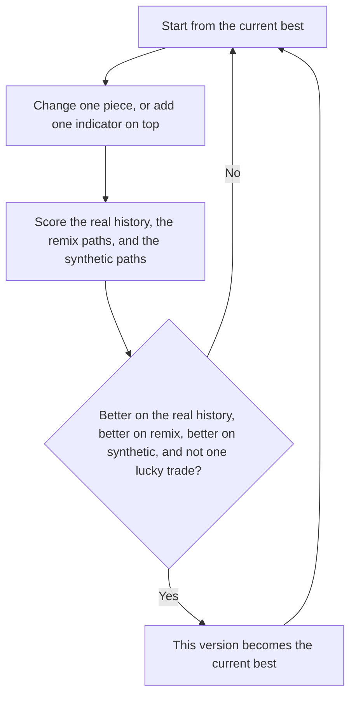

# CrashGate breeding

**Date:** 2026-10-07
**Status:** Draft for review
**Scope:** Change the CrashGate search so a try can add one known indicator on top of the current best rule, and so a try replaces that best only when it beats it on the real history and on both path families. The locked CrashGateV1 file stays unchanged.

This spec records the design agreed in chat. It extends `docs/superpowers/specs/2026-10-02-crashgate-search-design.md` and `docs/superpowers/specs/2026-10-05-indicator-search-design.md`. Where this spec is silent, those specs still apply.

## Goal

The search keeps one current best. It starts as the locked CrashGate rule. Each try changes that rule in one place, or adds one indicator on top of its buy. The try becomes the new best only when it is better on the real Coinbase history, better on the remix paths, better on the synthetic paths, and not wiped out by dropping one real-history trade. The next try then starts from that new best.

## Non-goals

- Editing `price_forecast/strategies/crashgate_v1.py`, its fill, its fee, or its locked behavior
- Testing an indicator with CrashGate switched off
- Calling the pivot script, or waiting 50 cycles to ask it for an outside idea
- Replacing the CrashGate shape with dual-average mode or prior-high mode
- Using the half-of-Coinbase-edge stress rule as the keep test
- Adding ATR, on-balance volume, or relative volume in this search
- Putting two new comparisons on the rule in one try

## One parent

The parent of every try is the current best. A try that fails the keep test is written to the ledger and then discarded. It is not a later parent. The pool no longer holds 20 members, and a try no longer picks a parent at random from that pool.

The current best is stored as the only pool member, and its id is `champion_id`. CrashGate is that member at the start. Its remix average and its synthetic average are stored on it and are the first bar later tries must beat.

## One change

Each try differs from the current best in exactly one of these ways.

**A CrashGate piece.** One ladder number moves to the next or previous allowed value, or one of `base_or_breakout` and `above_long_averages` flips. The ladders stay the ones already used for a threshold rule. The 8-week entry still moves to 6 or 10 weeks, not to 7. Any indicator comparisons already on the rule stay as they are.

**An added indicator.** One comparison from the menu below is added. The comparison is not already on the rule. The buy keeps every existing CrashGate entry check and adds this comparison. The sell stays the current best's sell. A later try can add a second comparison. It cannot add two in one try.

**A number on an indicator already added.** One number on one added comparison steps by the indicator step already defined for that series. A period, an RSI level, a stochastic level, or an ADX level steps by 1. A Bollinger width steps by 0.5. Every other field stays as it is. A step that would leave the legal range is not a legal edit.

A try does not switch the rule to `dual_average`, `prior_high`, or indicator-only mode. A try does not remove an added comparison.

The edit is chosen with the same seeded generator as today, from the legal edits of the current best. The same seed and cycle produce the same child from the same parent.

## Buy and sell

The fill stays the next weekly close. The fee stays 0.15% per fill. The start stays cash.

While the position is flat, it turns on when the CrashGate entry is true and every added comparison is true on that week. While the position is on, it turns off when the CrashGate exit is true. An added comparison does not sell by itself.

For the locked rule plus `rsi_14 < 30`, the buy is: close above the 8-week average, base-or-breakout on, above the long averages, and 14-week RSI below 30. The sell stays: close below the 16-week average, or a down week of 10% with the close below the 8-week average.

## Menu

Each row is one comparison. The words are the phrases the search already accepts. ATR is not on the menu. A fixed ATR cutoff only makes sense at one Bitcoin price. On-balance volume and relative volume are not on the menu. Remix files have no volume, so those additions have no remix average to compare.

| Comparison |
| --- |
| `rsi_14 < 30` |
| `rsi_14 > 70` |
| `stoch_14 < 20` |
| `stoch_14 > 80` |
| `stoch_d_14_3 < 20` |
| `stoch_d_14_3 > 80` |
| `roc_12 > 0` |
| `roc_12 < 0` |
| `macd_hist_12_26_9 > 0` |
| `macd_hist_12_26_9 < 0` |
| `close > sma_20` |
| `close > sma_50` |
| `close > sma_200` |
| `close < sma_20` |
| `close > ema_20` |
| `close > ema_50` |
| `ema_12 > ema_26` |
| `sma_50 > sma_200` |
| `macd_12_26 > 0` |
| `macd_12_26 > macd_signal_12_26_9` |
| `close < bb_lower_20_2` |
| `close > bb_upper_20_2` |
| `adx_14 > 25` |
| `close >= donchian_high_20` |
| `close <= donchian_low_20` |
| `close >= prior_high_20` |

## Keep test

The real-history score is the existing breeding number. Its baseline stays the locked CrashGate Coinbase metrics, so a later best is still scored against that same baseline. Higher means strictly greater.

The remix average is the arithmetic mean of the remix edges. The synthetic average is the arithmetic mean of the synthetic edges. Higher means strictly greater. The bar is whatever pair is stored on the current best, from that rule's own path run. On the locked CrashGate rule those stored averages are about -32 and about -40. Against that pair, a try at -10 and -15 is higher on both. A try at -10 and -50 fails, because -50 is worse than -40. The numbers -32 and -40 are not hardcoded.

The one-trade check is the existing fragile check. A try is wiped out when the Coinbase edge is positive and dropping any one completed round trip cuts that edge to half or less, or turns it non-positive.

A try becomes the new best only when all of these are true:

- Its breeding number is higher than the current best's breeding number.
- Its Coinbase edge is strictly positive.
- Its remix average is higher than the current best's remix average.
- Its synthetic average is higher than the current best's synthetic average.
- It is not wiped out by the one-trade check.

The half-of-Coinbase-edge comparison is not the keep test. Both path averages are still stored on the ledger row. When a try becomes the new best, its breeding number and both path averages become the bar the next try must beat.

An error try, including a try with no completed round trip, is discarded. It does not become the best.

## What this search no longer does

After 50 tries with no new best, the search does not write a pivot diagnosis and does not run `generate_pivots.py`. It does not test a phrase with CrashGate switched off. The next try is another one-piece change of the current best.

## Tests

Tests live under `tests/search/`. They use small fixtures. They do not generate 200 paths.

- A search run does not modify `price_forecast/strategies/crashgate_v1.py`
- From the locked rule, one edit moves the 8-week field to 6 or 10, flips one switch, or adds one menu comparison. It does not produce a `dual_average`, `prior_high`, or indicator-only spec
- Adding `rsi_14 < 30` keeps the locked sell. The position turns on only when the locked entry is true and RSI is below 30. It turns off on the locked exit while RSI is still below 30
- A second try can add one more menu comparison, or step the RSI period or the RSI level by 1. It cannot add two comparisons at once
- A try with remix average -10 and synthetic average -15 beats a best whose averages are -32 and -40 on the path check
- A try with remix average -10 and synthetic average -50 does not
- A try with a higher breeding number and a worse remix average does not become the best
- A fragile try does not become the best
- A try with a Coinbase edge that is not positive does not become the best
- After a try becomes the best, the next parent is that try, and the path bar is that try's two averages
- A failed try is not the next parent
- Fifty tries with no new best do not call the pivot script
